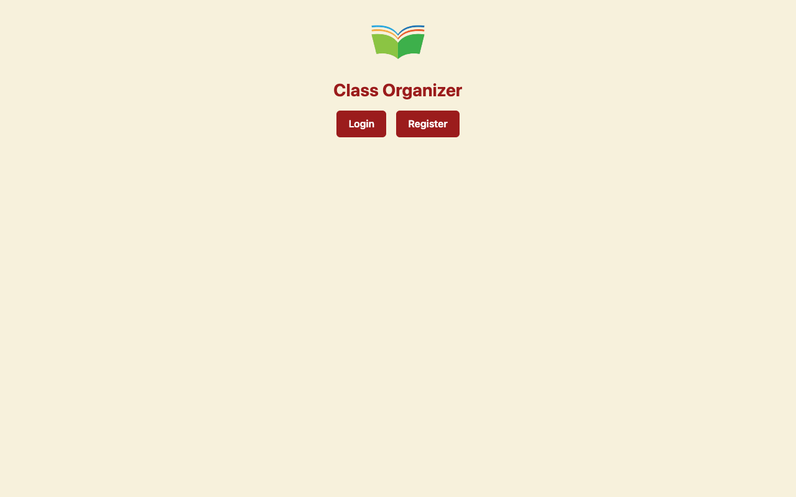
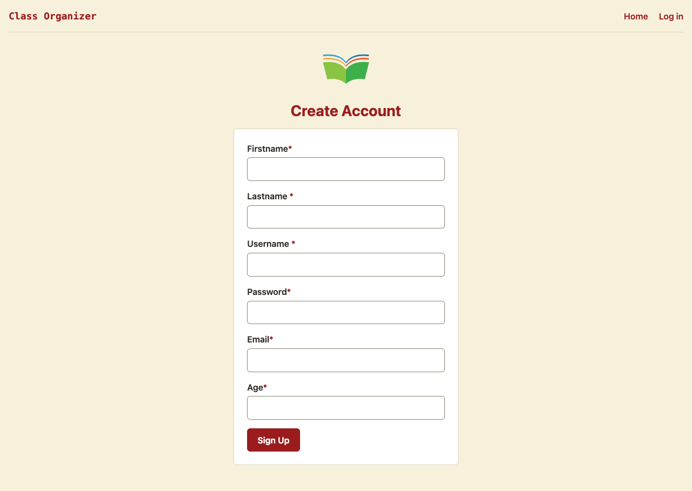
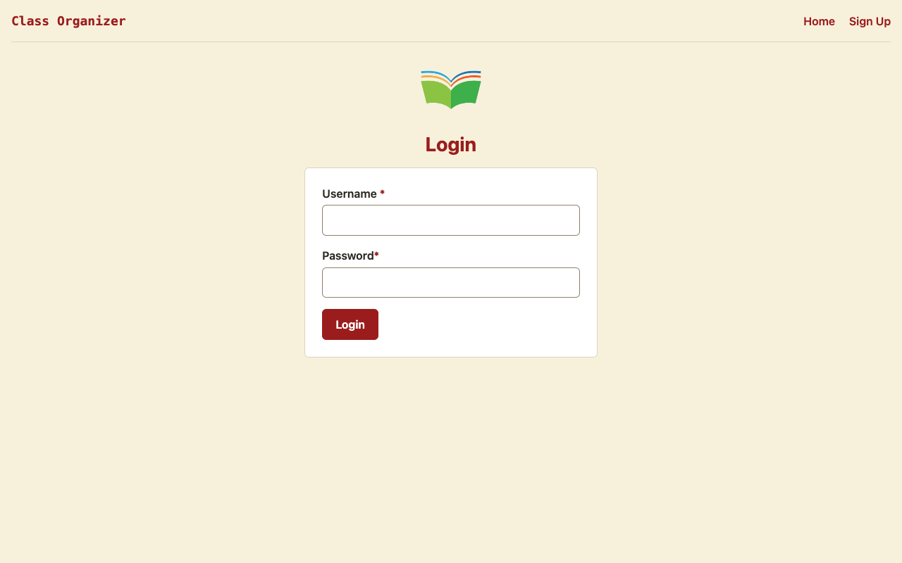
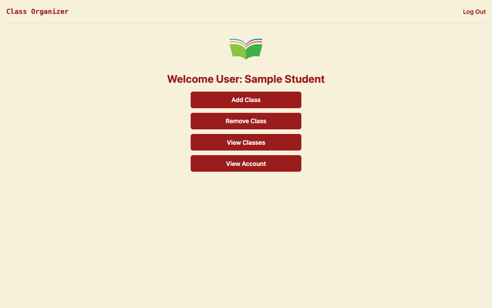
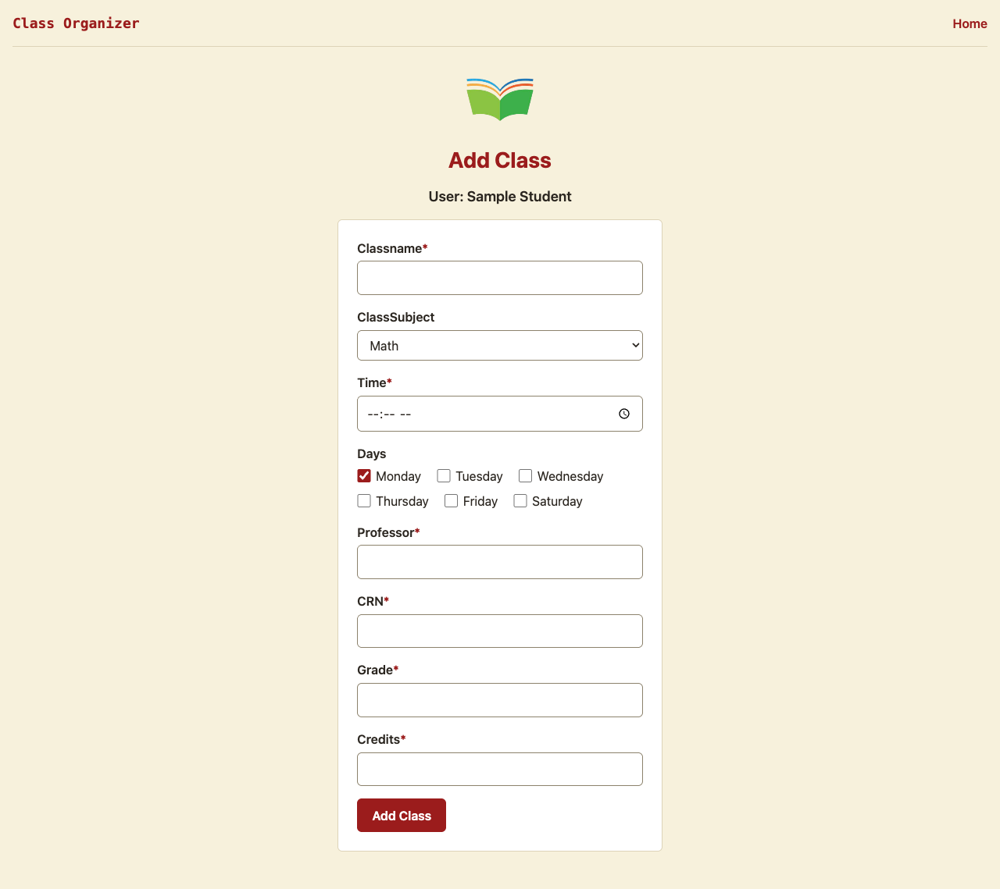
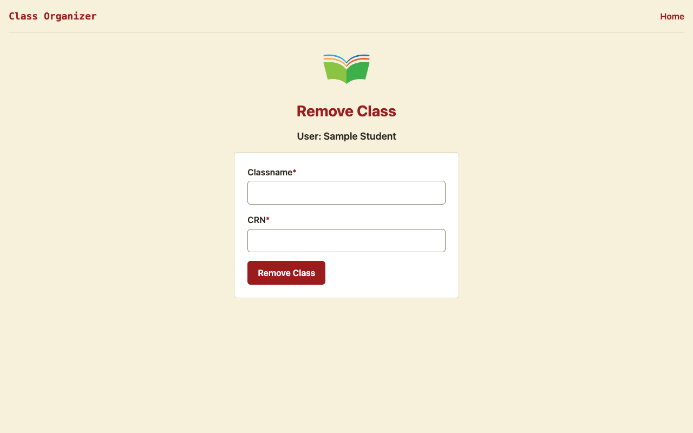
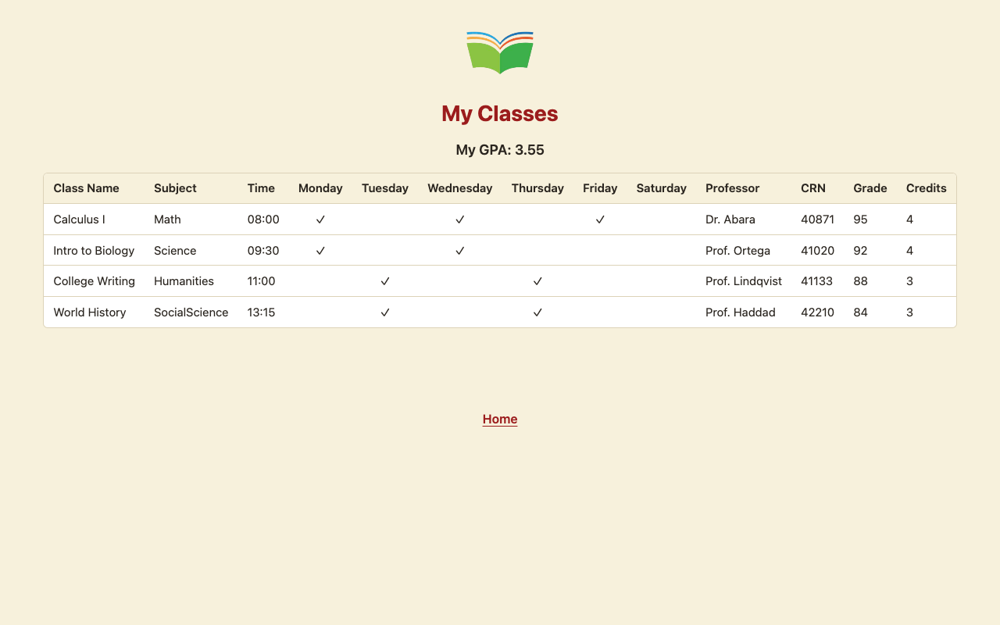
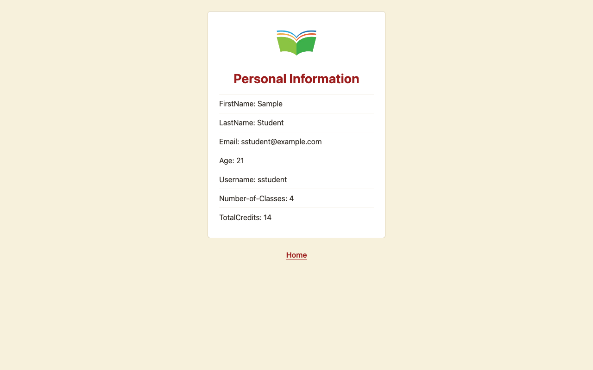

# Hello and Welcome to my First Full stack Project: Class Organizer

## 📋 Table of Contents

1. 🎯[The Problem](#the-problem-i-wanted-to-solve)
2. 🚀 [Running the Program](#running-the-program)
3. [Running the Tests](#running-the-tests)
4. [Using MySQL](#using-mysql)
5. 📦[Deployment](#deployment)
6. 💻 [The Tech](#the-tech)
7. [What changed in 2026, and why](#what-changed-in-2026-and-why)
8. 🎨[Design](#design)
9. 📬[Contact](#contact)
10. [Licence](#licence)

## <a name="the-problem-i-wanted-to-solve">🎯 The Problem</a>

For my first web app project, I aimed to address a common issue among my college classmates. The class schedule we received was not organized or visualized in a way that provided a clear understanding of how our days looked like. I set out to create a simple program that allows users to create an account, record their class data, and visualize a clearer schedule.

## <a name="running-the-program">🚀 Running the Program</a>

All you need is Java 17 or newer. From the project folder, run one command:

```
./mvnw jetty:run
```

Then open http://localhost:8080/ (on Windows the command is `mvnw.cmd jetty:run`). Stop it with Ctrl+C.

The Maven wrapper (`mvnw`) downloads the right Maven by itself, and Maven downloads everything else. Jetty, a small Java web server started through its official Maven plugin, serves the same servlets and JSP pages GlassFish did. I picked Jetty because its plugin runs the app straight from the source folders, JSP pages included, so one command builds and starts everything with nothing to install.

This way of running uses an embedded database: H2 in MySQL mode, kept in memory and built from `src/main/resources/schema.sql`. It needs no database server and starts empty every time. To use a real MySQL instead, see [Using MySQL](#using-mysql).

## <a name="running-the-tests">Running the Tests</a>

```
./mvnw verify
```

This runs 75 tests:

- **Rules:** password hashing, the form checks, letter grades, the GPA and the order of the schedule (`src/test/java/.../*Test.java`).
- **Database:** every query against a fresh embedded database, including that a stored password is a hash and that one student can never remove another's class (`DatabaseTest`).
- **The running app:** Maven starts the app on port 18089 and the tests walk every page over HTTP, like a browser: sign up, log in, add a class, see the schedule, remove a class, account info and log out, plus the security rules (`*IT.java`).

GitHub runs the same command on every push and pull request (`.github/workflows/build.yml`).

## <a name="using-mysql">Using MySQL</a>

MySQL is still the real database. The app reads the same three environment variables it always has:

| Variable | What it holds | Example |
| --- | --- | --- |
| `SQL_Connection` | The JDBC URL of the database | `jdbc:mysql://localhost:3306/classorganizer` |
| `user` | The database user | `classorganizer` |
| `password` | That user's password | (yours) |

When `SQL_Connection` is set, it wins over the embedded database. To run a MySQL on your own computer, `compose.yaml` starts one with Docker and loads `schema.sql` the first time:

```
export MYSQL_PASSWORD=pick-a-password
docker compose up -d
SQL_Connection=jdbc:mysql://localhost:3306/classorganizer user=classorganizer password="$MYSQL_PASSWORD" ./mvnw jetty:run
```

If you use a MySQL you set up yourself (Amazon RDS, for example), run `src/main/resources/schema.sql` against it once first.

Note: the 2026 update was built and tested against the embedded database. The MySQL route above was written and checked by reading, but not yet run against a live MySQL.

## <a name="deployment">📦 Deployment</a>

After building the application, you are provided with a WAR file that can be used to deploy the project. I deployed this project on Amazon Web Services using an EC2 instance in the same VPC as my RDS. My EC2 was in a public subnet, and my RDS remained in a private subnet for secure data storage. I used SSH protocol to transfer the WAR file to my EC2 instance.

Today `./mvnw package` still builds that WAR in `target/`. It runs on any Jakarta EE 10 server, such as GlassFish 7, with `SQL_Connection`, `user` and `password` set on the server.

## <a name="the-tech">💻 The Tech</a>

- **Frontend:** HTML, CSS, JSP 
  
  

- **Backend:** Java 17, Servlet API (Jakarta Servlet 6.0) 

- **Database:** MySQL, with H2 in MySQL mode for local runs and tests 

- **Server:** Jetty 12 for local runs, GlassFish 7.0 or any Jakarta EE 10 server for the WAR 

- **Build and tests:** Maven, JUnit

- Object-oriented programming approach

## <a name="what-changed-in-2026-and-why">What changed in 2026, and why</a>

The app looks and works the same. Underneath, it is now done the way I would do it today. Each point names the old way, the new way and the reason, with the C# idea it matches.

- **Passwords.** Before, they were stored and compared as plain text. Now they are stored as salted PBKDF2 hashes from the JDK (`Passwords.java`), 600,000 rounds, compared in constant time. A leaked table should never leak passwords. It is the same idea as `Rfc2898DeriveBytes.Pbkdf2` in .NET, and Java needs no library for it.
- **SQL.** Before, some queries glued typed text into the SQL (`"... where username='" + equal + "'"`), so a username could rewrite the query. Now every query is a `PreparedStatement` with `?` parameters, like `SqlParameter` in ADO.NET. That is what stops SQL injection.
- **Closing what you open.** Before, connections, statements and results were never closed, so every page leaked a database connection. Now each one sits in try-with-resources, `try (Connection c = ...) { }`, which is Java's `using`.
- **Login.** Before, the app looked the account up by its password, so two students with the same password could end up in each other's accounts. Now it finds the account by username, then checks the password against the stored hash, with the same message for a wrong name or a wrong password.
- **Sessions.** Before, a page behind the login crashed for a visitor with a stack trace, the session id stayed the same after login, and Log Out only went back to the home page. Now one filter (`LoginFilter`, much like ASP.NET middleware or `[Authorize]`) guards those pages, logging in starts a new session and `/logout` ends it.
- **One student, one schedule.** Before, Remove Class only compared against the first class on the account, then deleted that CRN for every student. Now every query on classes carries the student's id in its WHERE clause, and a test proves one student cannot read or remove another's classes.
- **Checking input.** Before, the Add Class check looked at the field names instead of their values, Create Account ignored its own check, and a blank number crashed the page. Now `Validation.java` checks every field on the server and shows a plain message on the same page. The browser's `required` is only a hint; anyone can send a request without it.
- **Escaping.** Before, names and class names went into the page as raw HTML, so a "name" could carry a script. Now everything a user typed goes through `Html.escape`. Razor does this for you with `@`; JSP and servlets do not.
- **Errors.** Before, exceptions were printed to the console or swallowed. Now they travel up as checked exceptions (`throws SQLException`: unlike C#, Java makes you handle or declare them), the servlet logs the cause and the student sees one plain line. Anything unexpected lands on a plain error page set in `web.xml`.
- **Dependencies.** Before, the MySQL driver jar was committed in `WEB-INF/Lib` (Linux servers only look in `lib`, lowercase) and the IDE's `.idea` folder was in the repo. Now Maven fetches the driver, every version is pinned in `pom.xml`, and `.gitignore` keeps jars and IDE files out. It is the NuGet way: declare a package, never commit it.
- **Names and records.** Before, there were classes called `myClass`, `account` and `table`, and rows were passed around as `ArrayList<ArrayList>`. Now classes use PascalCase like in C# (`Account`, `Table`, `SchoolClass`), and a row is a `record` (`Customer`, `SchoolClass`), just like a C# record.
- **Running and testing.** Before, you needed GlassFish and a MySQL to see anything, and there were no tests. Now `./mvnw jetty:run` starts it with an embedded database, and `./mvnw verify` runs 75 tests with JUnit (Java's xUnit), on GitHub too.

# <a name="design">🎨 Design</a>

## <a name="home">Home</a>


## <a name="create-account">Create Account</a>


## <a name="login">Login</a>


## <a name="landing">Landing</a>


## <a name="add-class">Add Class</a>


## <a name="remove-class">Remove Class</a>


## <a name="schedule">Schedule</a>


## <a name="account-info">Account Info</a>


## <a name="contact">📬 Contact</a>
[](https://www.linkedin.com/in/tomy-romero-902476145/)
Any questions, comments, or concerns, email me at tomyfletcher99@hotmail.com. Hope you guys enjoy.

## <a name="licence">Licence</a>

The code is under the MIT licence: see [LICENSE](LICENSE).

The libraries it uses keep their own licences, and none of them is committed here; Maven downloads them when it builds. The MySQL driver (MySQL Connector/J), which goes into the WAR, is under the GNU GPL version 2 with the Universal FOSS Exception, which allows using it with an open source project under MIT. The embedded H2 database, also in the WAR, is under the MPL 2.0 or the EPL 1.0. Jetty, JUnit and the Servlet API are only used to build, run and test the app and are not shipped with it.
